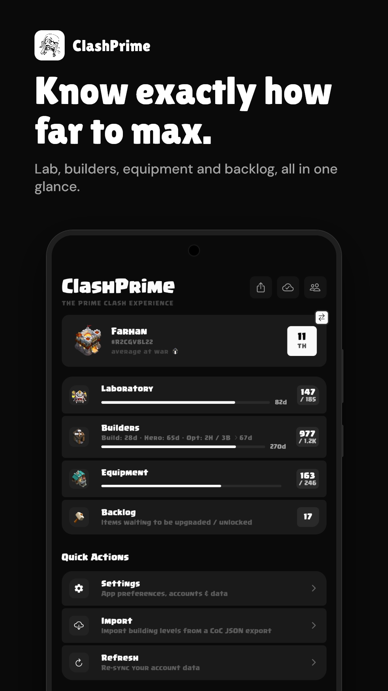
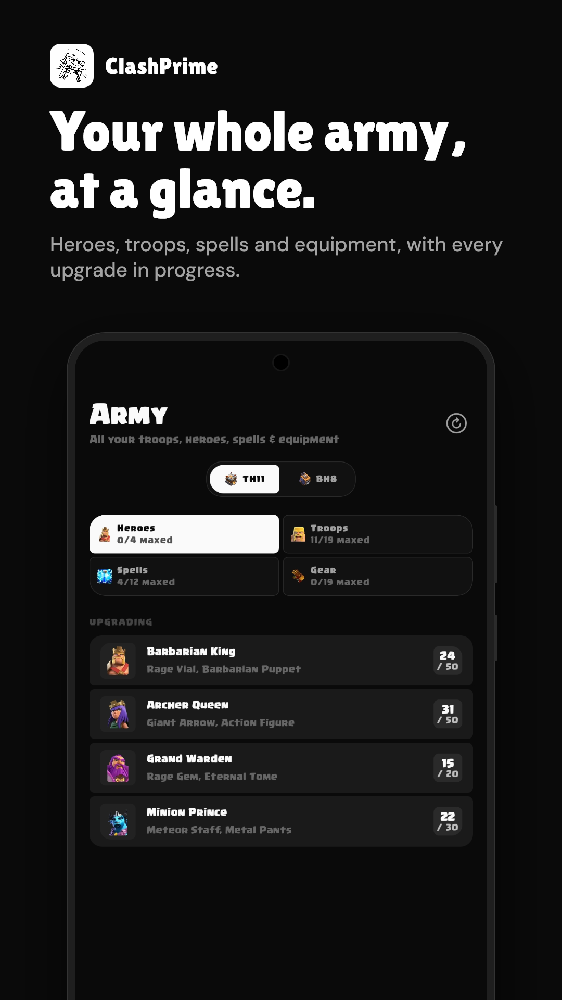
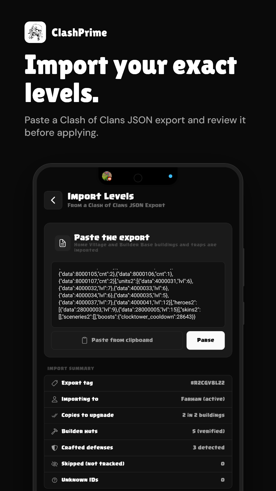
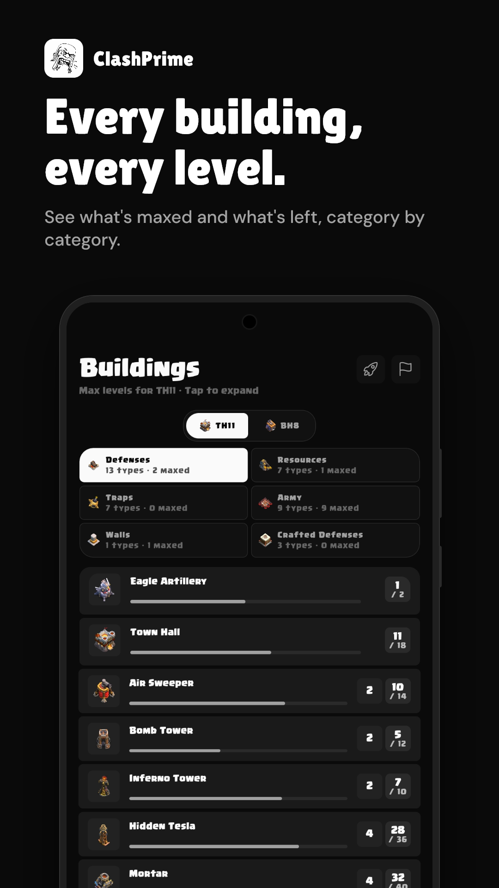
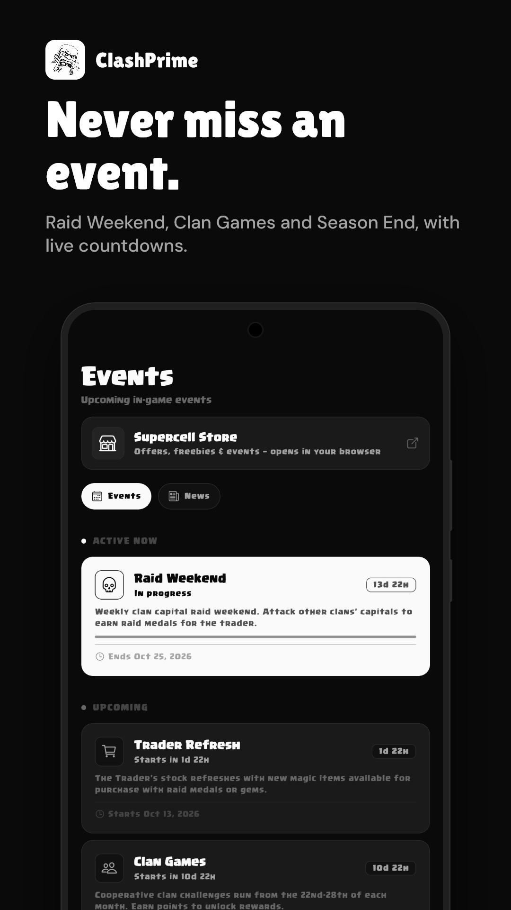
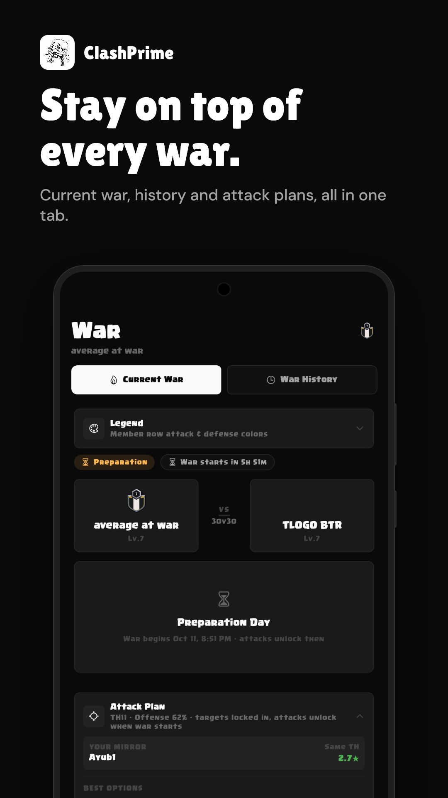
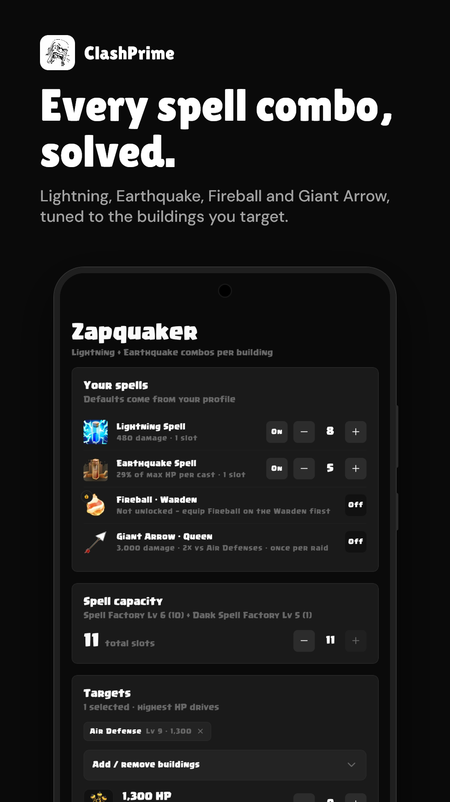
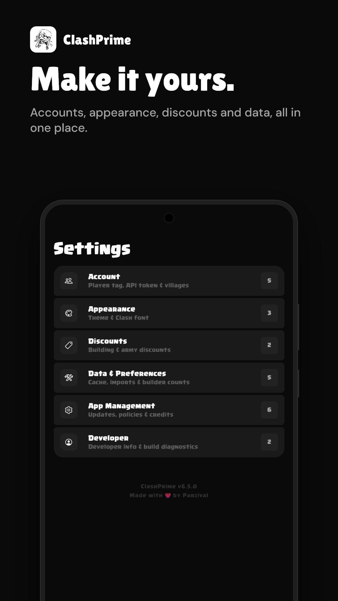
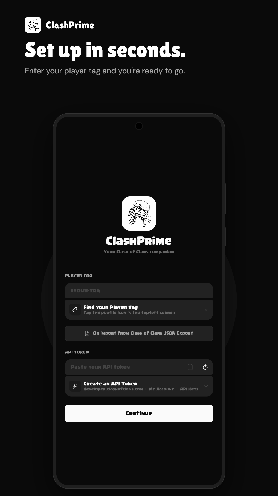
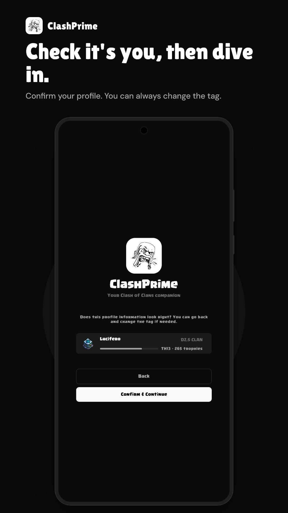

# ClashPrime

A premium monochrome companion app for Clash of Clans — track your progress, manage armies and bases, explore building levels, follow wars, and stay on top of events.

<p align="center">
  
</p>

## Screenshots

A quick tour of ClashPrime. Expand a section to see its screens with what each one does.

<p align="center">
  
  
  
  
  
</p>

<details open>
<summary><b>Track your progress</b> · Home, Time to Max, Import, Multi-Account</summary>

<table>
<tr>
<td width="50%" valign="top">

<b>Home Dashboard</b><br/>
Your village at a glance: progress cards, league details, quick stats and quick actions.
</td>
<td width="50%" valign="top">

<b>Time to Max</b><br/>
Lab, Builders, Pets and Equipment pipelines side by side, with a headline time to max and a rush-to-TH+1 comparison.
</td>
</tr>
<tr>
<td width="50%" valign="top">

<b>Import / Export</b><br/>
Paste a CoC JSON export to set levels for Home Village and Builder Base, and see only the upgrades that are left.
</td>
<td width="50%" valign="top">

<b>Multi-Account</b><br/>
Switch between player tags. Each account keeps its own levels, builders, saved bases and last-synced time.
</td>
</tr>
</table>

</details>

<details>
<summary><b>Army and Buildings</b> · Army, Heroes, Buildings</summary>

<table>
<tr>
<td width="50%" valign="top">

<b>Army</b><br/>
Troops, heroes, spells, pets and equipment with level tables, discount-aware cost and time, and a Home / Builder Base switch.
</td>
<td width="50%" valign="top">

<b>Hero detail</b><br/>
Level stats, remaining cost and time for every hero level, folded to your current level so long tables stay readable.
</td>
</tr>
<tr>
<td width="50%" valign="top">

<b>Buildings</b><br/>
80+ buildings with level progression, grouped multi-copy sections, per-building discounts and Crafted Defenses.
</td>
<td width="50%" valign="top"></td>
</tr>
</table>

</details>

<details>
<summary><b>Live in-game</b> · Events, War</summary>

<table>
<tr>
<td width="50%" valign="top">

<b>Events</b><br/>
Upcoming in-game events with countdown timers and progress bars.
</td>
<td width="50%" valign="top">

<b>War</b><br/>
Live war tracking with attack dots and defense shields, Clan War League rounds and a searchable war history.
</td>
</tr>
</table>

</details>

<details>
<summary><b>Libraries</b> · Base Library, Army Library</summary>

<table>
<tr>
<td width="50%" valign="top">

<b>Base Library</b><br/>
Browse Home Village and Builder Base layouts from ClashLy and clash-bases, grouped by year and sorted by popularity.
</td>
<td width="50%" valign="top">

<b>Army Library</b><br/>
Community armies from ClashArmies with TH filtering, favorites, in-game copy and share cards.
</td>
</tr>
</table>

</details>

<details>
<summary><b>Planners and tools</b> · Hero Journey, 6th Builder, Zapquaker, Giant Arrow</summary>

<table>
<tr>
<td width="50%" valign="top">

<b>Hero Journey</b><br/>
The Chief's Journey rewards track from TH7 to TH18, with claimed badges and a shortcut to your next claimable milestone.
</td>
<td width="50%" valign="top">

<b>6th Builder (B.O.B.)</b><br/>
A resource-feasible schedule for all seven B.O.B. unlock requirements, with ETAs and "what is blocking you" callouts.
</td>
</tr>
<tr>
<td width="50%" valign="top">

<b>Zapquaker</b><br/>
Per-building Zap + Quake combo calculator, with Fireball and Giant Arrow equipment in the mix and the cheapest kill combos suggested.
</td>
<td width="50%" valign="top">

<b>Giant Arrow</b><br/>
Plan the Archer Queen's arrow on a base screenshot and share it as a high-res PNG. Rocket Backpack mode included.
</td>
</tr>
</table>

</details>

<details>
<summary><b>Settings and first run</b> · Settings, Onboarding</summary>

<table>
<tr>
<td width="50%" valign="top">

<b>Settings</b><br/>
API token, dark mode, discounts, account management, a Show Global Levels toggle and a What's New changelog.
</td>
<td width="50%" valign="top">
<b>Onboarding</b><br/>
A guided first run: confirm your profile, pick your Town Hall, and see every data source on the Data &amp; Credits slide before entering the app.
</td>
</tr>
</table>

<p align="center">
  
  
  
  
</p>

</details>

## Features

- **Home Dashboard** — overview of your village with progress cards, quick actions, **League section** (badge, bonus, loot, star bonus, ore), quick stats, and a **Progress Achieved dialog** that also tracks Builder Base troop and hero progress
- **Time to Max** — **Home / Builder Base switch** (hall-art pills) over parallel pipelines (**Lab**, **Builders**, **Pets**, **Equipment** at home; **BB Builders** / **Star Lab** on Builder Base) showing remaining upgrade time & resources per category, with a headline time, split rows and a resource chip grid; **chain-scheduled builder time** (LPT bin-packing of serial upgrade chains) so a single long hero upgrade correctly bounds the result. **In-place strategic exclusions** — toggle *Exclude* on the Pipelines header to skip any building or single army item straight from its row (gate items like the Lab, Hero Hall, Pet House, Blacksmith, Star Lab and Builder Barracks are marked and can't be toggled alone), with excluded time/resources surfaced in the summary and a Restore button. A **rush-to-TH+1 comparison** shows next-TH time & cost in rounded zebra tables, and the new-unlock rows carry each item's unlocking building/level with its upgrade cost & time (plus extra buildable copies)
- **Import / Export** — bulk import building levels from a CoC JSON export covering **Home Village and Builder Base**, plus **crafted-defense module levels**; shows **only real upgrades** (skips buildings already at target), per-copy current levels, a builders pipeline with chain-scheduled time & resource breakdown (Builder Base upgrades timed against their own builders — auto 2 at Builder Hall 6, max 3), spaced upgrade cards with proper corner rounding, in-game resource icons on upgrade rows, and an auto-detected **Builder Hut count** in the parse summary that sets (with a verified floor) the builders for the account being applied to
- **Multi-Account** — add and switch between multiple player tags from Settings or the Home dashboard. Each account keeps its own building levels, crafted-defense modules, saved bases, favorites, **builder counts** (Home and Builder Base) and **last-synced time** (shown in the account switcher). Shared data (events, troop details) is fetched once.
- **Army** — troops, heroes, spells, pets, equipment (including Builder Base items) with images, level stats tables (with acronym legend), progress tracking, and discount-aware cost/time columns; a **Home / Builder Base switch** splits the chip rows, and hero level tables **fold to your current level** (with an "N earlier levels hidden" caption) so long hero ranges stay readable
- **Buildings** — expandable cards showing all 80+ buildings with level model progression, stat tables (Home Village + Builder Base), and per-building discount toggles. Multi-copy buildings (Cannons, Walls, Traps, etc.) are grouped into collapsible sections with per-copy level tracking, aggregated remaining cost/time, and quick upgrade/downgrade controls. Includes a **Crafted Defenses** category (Crafting Station) with per-module steppers, effective-level sprites and cost-to-max, category pills two-per-row, and a village switch. Any **Remaining** total (single card, grouped section or Army sheet) can be **capped to a chosen level** by long-pressing a level row — the header turns gold with a one-tap clear
- **Events** — upcoming in-game events with countdown timers and progress bars
- **War** — live war tracking with per-member attack dots and defense shields, plus live Clan War League rounds (expandable per-member breakdowns, W/L/D per round) and a searchable war history split into regular wars and CWL
- **Base Library** — browse Home Village and Builder Base layouts from two merged catalogues: ClashLy's live API (popularity metrics, ratings, Builder Base coverage) plus the static [clash-bases](https://github.com/nschmeller/clash-bases) catalogue (real base names, descriptions, builder credits, tags and Progress/Fun categories), deduplicated by official in-game layout link. A Both / ClashLy / Clash Bases source switch beneath the village selector browses either catalogue alone. Grouped by year and sorted by popularity, paginated with end-of-list feedback. Loads from the on-device snapshot first (3-day TTL) and refreshes in the background, so returning to the tab is instant
- **Army Library** — community army compositions from ClashArmies with TH-level filtering, save/favorite, in-game copy, share card, and end-of-list feedback. Same cache-first loading as the Base Library
- **Hero Journey** — the Chief's Journey rewards track from TH7 to TH18 (quests, ore, hero equipment, potions, books, runes and Majestic skins) as milestones grouped into collapsible Town Hall sections, with claimed badges, lock icons, owned-hero portraits in the section headers and a shortcut that flags the next milestone you can claim
- **Discount System** — modal with per-scope (Buildings / Army) cost and time reduction sliders, preset pills, custom percentage input, and instant preview across all tabs
- **Saved** — quick access to saved and favorited bases and armies, with full army cards and share actions
- **Zapquaker** — per-building Zap + Quake combo calculator: pick buildings from game data, tune Lightning/Earthquake levels and spell capacity, flip each spell On/Off, and bring Fireball or Giant Arrow equipment (own level steppers) into the mix. Suggests the cheapest kill combos by spell slots with spell-only and equipment-lean variants and overkill %
- **Giant Arrow** — plan the Archer Queen's arrow on a base screenshot: tap/drag start and end pins, pick a path color, auto-save/restore on device, and share the finished plan as a high-res PNG (3x capture) from the editor or fullscreen viewer. A **Rocket Backpack** mode (Dragon Duke) reuses the canvas with a center pivot so the dash line always runs through the base center
- **6th Builder (B.O.B.)** — Builder Base planner that turns your player profile into an ordered, resource-feasible schedule for all seven B.O.B. unlock requirements (3 gear-ups, troop lvl 18, defence lvl 9, BM+Copter 45, B.O.B Control 5): requirement checklist (3 gear-up toggles persist locally), machine timeline grouped by bb-builder / star-lab with per-chain ETA and cost badges, storage-feasibility cascades that auto-insert storage upgrades, Builder Hall gate chains, Clock Tower value, and "what is blocking you" callouts
- **Awards** — standalone tab with star summary and village-filtered achievement list, filtered through the same seamless pill grid used by Bases, Armies and Hero Journey (Town Hall and Builder Hall art per village, award counts on each pill)
- **Settings** — API token, dark mode, discounts, account management, a **Show Global Levels** display toggle (expand level tables past your Town Hall), and a **What's New changelog**, all in collapsible section headers (icon, description and count badge) that expand in place; every dialog opens as a bottom sheet. About, Credits, Privacy Policy, Feedback (farhanzafarr.9@gmail.com) and Developer Info
- **Onboarding** — guided first-run flow with an image-based Town Hall picker, an Add Account (Full Setup) flow, masked token entry with per-step loading art, and a **Data & Credits** slide that lists every public source before entering the app
- **Timers** — custom duration parsing (1d 2h 3m), dashed "Add timer" row at list end with proper isFirst/isLast rounding, and an ongoing notification with an **Android-native per-second countdown** that keeps ticking even when the app is killed (zero battery) plus sound/vibration on finish
- **Version Checker** — compares the running build against GitHub release tags; update badges in Home & Settings with one-tap release links and ahead-of-release detection

## Design

Monochrome palette (`#0A0A0A` → `#FAFAFA`), 8pt spacing system, decreased roundedness, and an icon-only bottom navigation with pageable tab groups (prev/next arrows) when the tab set overflows.

- **Dynamic Theme Engine** — Full runtime support for switching between Dark Mode and Light Mode, utilizing a dynamic StyleSheet proxy that maps color tokens instantly across all components.
- **Theme-Aware Skeletons** — Custom animated skeleton loaders that mimic tab structures (Home, Army, Bases, Armies, Events) and transition smoothly between themes.

## Tech Stack

| Layer | Technology |
|-------|-----------|
| Framework | Expo SDK 57 + React Native 0.86 |
| Navigation | expo-router (file-based) |
| Language | TypeScript 6.0 |
| Storage | AsyncStorage |
| Status Bar | expo-status-bar (hidden) |
| Linting | ESLint (eslint-config-expo) + React Compiler |
| SVG | react-native-svg |
| Gesture | react-native-gesture-handler |
| Media Picker | expo-image-picker |
| Sharing | expo-sharing + react-native-view-shot |

## API

Uses the official Clash of Clans API via the [RoyaleAPI proxy](https://docs.royaleapi.com/proxy.html) (for servers with dynamic IPs):
- Endpoint: `https://cocproxy.royaleapi.dev/v1/players/{tag}`
- Auth: Bearer token
- Players enter their own API token and player tag in the onboarding flow

> **Important:** When creating your API key at [developer.clashofclans.com](https://developer.clashofclans.com), you must whitelist the proxy IP: **`45.79.218.79`** — otherwise requests will be rejected.

## Data Sources

| Data | Source | Method |
|------|--------|--------|
| Player data | CoC API | REST fetch (Bearer token) |
| Base layouts (Home & Builder Base) | ClashLy API + clash-bases | ClashLy: REST fetch (Parse server). clash-bases: static `bases.json` from GitHub raw, merged by layout payload. 3-day on-device snapshot |
| Community armies | ClashArmies | Devalue-format REST fetch with 3-day snapshot |
| Troop, hero, spell, pet, equipment & siege machine details (levels, costs, stats, images) | clash-of-clans-data (npm) | Bundled package data (canonical) |
| Building images, levels, TH max, copy counts (Home & Builder Base) | clash-of-clans-data (npm) | Bundled package data (canonical) |
| Crafted-defense modules, effective levels & tiered sprites | clash-of-clans-data (npm) | Bundled package data (canonical) |
| **Max Town Hall** | clash-of-clans-data (npm) | **Derived from `townHallRequired` across all building levels** (falls back to 18) |
| League loot/bonus/ore info | clash-of-clans-data (npm) | Bundled package data (canonical) |
| Events | clash.ninja | Runtime HTML scraper |
| TH max levels (fallback) | clash.ninja | Runtime HTML scraper with section-hash caching |

## Credits & Attribution

ClashPrime is an unofficial fan project. It gathers reference data and content from the following public sources — please support them:

| Project / Site | Used for | Homepage |
|----------------|----------|----------|
| Clash of Clans API | Player stats & progress | [developer.clashofclans.com](https://developer.clashofclans.com) |
| RoyaleAPI proxy | Stable API access for dynamic-IP setups | [docs.royaleapi.com/proxy.html](https://docs.royaleapi.com/proxy.html) |
| ClashLy | Base layout library & ratings | [clashly.com](https://clashly.com) |
| clash-bases | Static base layout catalogue (names, tags, builder credits) | [github.com/nschmeller/clash-bases](https://github.com/nschmeller/clash-bases) |
| ClashArmies | Community army compositions & sharing | [clasharmies.com](https://clasharmies.com) |
| clash-of-clans-data (npm) | Troop/hero/spell/pet/equipment/siege machine & building data (levels, costs, stats, images) | [npmjs.com/package/clash-of-clans-data](https://www.npmjs.com/package/clash-of-clans-data) |
| clash.ninja | In-game events & TH max level fallback | [clash.ninja](https://clash.ninja) |
| Zapquaker | Inspiration for the Zapquaker tab (Zap & Quake combo calculator) | [zapquaker.netlify.app](https://zapquaker.netlify.app/) |
| Otaku Planner | Inspiration for the Giant Arrow tab (Giant Arrow path planner) | [otakuplanner.com/tools/coc-arrow-path](https://otakuplanner.com/tools/coc-arrow-path) |

These credits are also shown in-app under **Settings → Credits**, where each source is tappable.

> **Supercell fan-content notice:** This content is not affiliated with, endorsed, sponsored, or specifically approved by Supercell and Supercell is not responsible for it. For more information see Supercell's Fan Content Policy: [supercell.com/fan-content-policy](https://supercell.com/en/fan-content-policy/).

## Project Structure

```
ClashPrime/
├── app/                    # Screens (expo-router file-based)
│   ├── _layout.tsx         # Root layout with auth gate
│   ├── onboarding.tsx      # First-run token + tag input
│   ├── import-export.tsx   # Bulk import building levels from CoC JSON export (Home Village + Builder Base, chain-scheduled pipeline)
│   └── (tabs)/             # Tab screens
│       ├── _layout.tsx     # Bottom tab navigator (Time to Max promoted to main)
│       ├── index.tsx       # Home Dashboard (with League section in Quick Stats)
│       ├── army.tsx        # Player Army
│       ├── buildings.tsx   # Buildings
│       ├── events.tsx      # Events
│       ├── bases.tsx       # Base Library
│       ├── armies.tsx      # Army Library (ClashArmies)
│       ├── maxtime.tsx     # Time to Max (Home/BB switch: pipelines, in-place exclusions, rush comparison)
│       ├── hero-journey.tsx# Chief's Journey rewards track (quests, ore, equipment, potions, books, runes, skins)
│       ├── saved.tsx       # Saved & Favorites
│       ├── war.tsx         # War & CWL
│       ├── achievements.tsx# Awards
│       ├── zapquaker.tsx   # Zapquaker combo calculator
│       ├── giantarrow.tsx  # Giant Arrow / Rocket Backpack path planner on base screenshots
│       ├── bob.tsx         # 6th Builder (B.O.B.) unlock planner
│       └── settings.tsx    # Settings (collapsible section headers + What's New changelog)
├── src/
│   ├── api/                # API clients and scrapers
│   │   ├── clash.ts        # CoC API client
│   │   ├── baseScraper.ts  # Base layout fetcher: ClashLy + clash-bases merge (3-day snapshot)
│   │   ├── clashBases.ts   # Static clash-bases catalogue fetcher (GitHub raw bases.json)
│   │   ├── clashArmies.ts  # ClashArmies popular armies fetcher with devalue parser (3-day snapshot)
│   │   ├── troopDetail.ts  # TroopDetail types (levels from package)
│   │   ├── eventsScraper.ts# Events scraper
│   │   └── newsScraper.ts  # In-game news scraper
│   ├── components/         # Shared UI components (ItemCard, bottom-sheet panels, skeletons, …)
│   ├── data/               # Static data (packageImages.ts incl. crafted-defense tiers, cocBuildingIds.ts incl. crafted/module IDs, attribution.ts, entityReference.ts)
│   ├── hooks/              # Player context, per-account builder count, storage
│   ├── theme/              # Design system (colors, spacing, typography)
│   ├── types/              # TypeScript interfaces
│   └── utils/              # armyData, bobPlanner (B.O.B. scheduling), buildingData (getMaxTownHall), buildingImages, craftedDefenses (module levels, effective level, cost-to-max), exclusions (pipeline exclusions & gates), heroJourney (Chief's Journey track), statImages, thReadiness, thMaxLevels, upgradeCosts (chain scheduling), upgradePivot (level-capped Remaining), zapquake (combo math), versionCheck, etc.
├── scripts/                # Generators: gen-package-images.mjs (128px WebP shrink → packageImages.ts), gen-coc-ids.mjs (emits crafted-defense/module ID maps), check-coc-data.mjs, preview-image-cap.mjs (shrink QA previews)
├── images/                 # App icons and logos
```

## Getting Started

```bash
# Install dependencies
npm install

# Start the dev server
npx expo start

# Run on specific platform
npx expo start --android
npx expo start --ios
```

### First Launch

1. Open the app — you'll see the onboarding screen
2. Get your API token from [developer.clashofclans.com](https://developer.clashofclans.com)
3. When creating your API key, whitelist the proxy IP: **`45.79.218.79`** — the app uses the RoyaleAPI proxy to support dynamic IPs
4. Find your player tag in-game (e.g., `#YYYYY`)
5. Enter both and tap **Connect**

## Generator Scripts

```bash
# Generate packageImages.ts (bundled images for troops, heroes, spells, pets, equipment, siege machines, buildings)
npm run gen:images

# Same, but re-encode even when the outputs already exist (after a failure, or to apply new encode settings)
npm run gen:images:force

# Render side-by-side original vs capped previews (assets/shrink-preview/preview.html) for visual QA
npm run preview:cap

# Generate cocBuildingIds.ts (building ID mapping for API)
npm run gen:coc-ids
```

`gen-package-images.mjs` re-encodes every source sprite to WebP (quality 80, effort 4) capped at **128 px** on the longest edge — well above the largest on-screen use (~210 physical px @3x for the 70 dp home hall art) — shrinking the packed tree from ~45 MB to ~7 MB. Each output is written at most once per run even when several entries share a source, and file writes are retried so a transient lock (e.g. Windows Defender) can't drop a `require` from the generated map; if a rewrite fails but the output already exists, the existing file is kept. Sources that fail to decode (e.g. an HTML error page from upstream) are skipped with a warning instead of emitting a broken entry.

### When `clash-of-clans-data` updates upstream

```bash
npm run sync:coc-data         # installs latest package, regenerates images & ID mapping, then prints a change report
npm run sync:coc-data:accept  # accepts the new data as the baseline (run after reviewing the report)
npx tsc --noEmit              # sanity check for schema changes
```

`sync:coc-data` ends with `check:coc-data`, which diffs the newly installed data against the
baseline in `scripts/coc-data-baseline.json.gz` and reports what was added, removed and changed,
with field-level diffs (e.g. `levels[2].stats.normal.dps  230 -> 220`). It compares against the
committed baseline rather than the network, so it works offline and in CI. Run it on its own any
time with `npm run check:coc-data`; add `--json` for machine-readable output or
`--print home/troops/thrower.json` to dump one entity.

`images` fields are excluded from the diff — they are asset paths, not game data — and key order is
normalized, so only real data changes are reported.

Then commit the regenerated `src/data/` files + lockfile, push, and tag the release (e.g. `v6.0.0`) so the in-app version checker picks it up.

> The old Fandom wiki scrapers in `scraper/` are deprecated — all building/troop data now comes from `clash-of-clans-data` npm package.

## Roadmap

- **Time to Max enhancements** — Hero equipment pipeline, season/tournament integration, exportable upgrade plan.
- **Clan War Leagues** — Live CWL rounds are now tracked on the War tab. Remaining: medal tracking and promotion/ranking through a league season.
- **Landing page** — A simple static HTML page for web presence, deployed via Vercel from the same repo.

## Future Considerations

- **Fork `clash-of-clans-data`** — Upstream is pre-1.0 and updates on Supercell's schedule. Consider forking as `@clashprime/clash-of-clans-data` with a sync script to apply custom mappings (display names, BB building fixes, image paths) and publish on our own cadence when new content drops.
- **Offline-first sync** — Player data and the base/army libraries are cached on device and served instantly; remaining: full offline coverage for reference data with background sync when online.
- **Clan roster management** — Track member donations, war participation, and activity across seasons.
- **Push notifications** — Event start/end, war attacks. Builder/upgrade timers already ship as native countdown notifications; remaining: event and war attack alerts.
- **Builder chain planner** — Visual scheduler for serial upgrade chains across N builders with drag-to-reorder.

## License

MIT
